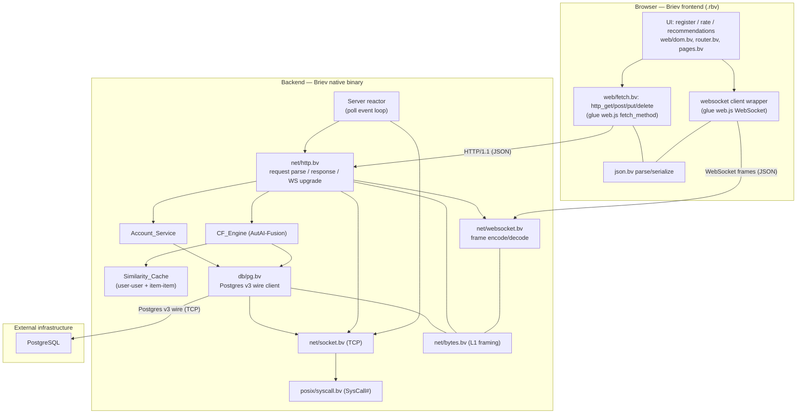
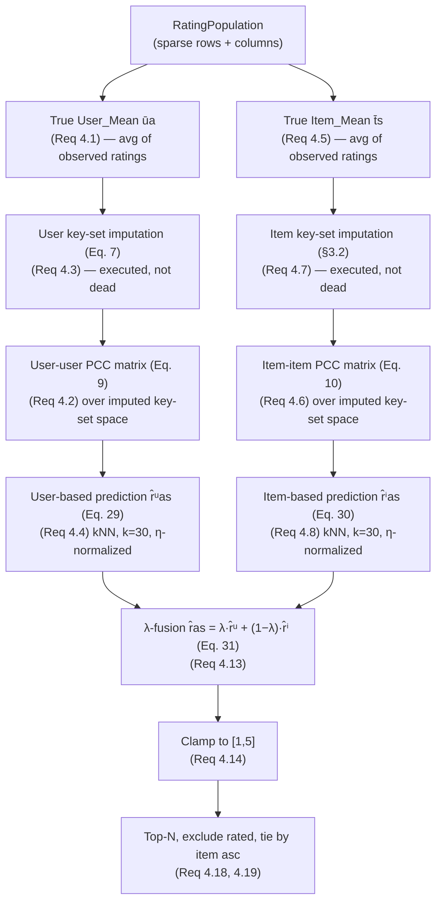
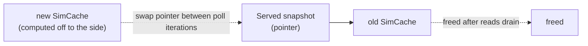

# Design Document: Recommender App

## Overview

The Recommender_System is a movie-recommender web application written **entirely
in Briev** — both the browser frontend (compiled to `.rbv` and reaching the host
through the web glue) and the native backend (compiled to a native binary) — with
PostgreSQL as the only external infrastructure, reached through a Briev-written
wire-protocol client. The backend implements the full paper-faithful
**AutAI-Fusion** collaborative-filtering predictor (user-based Eq. 29 and
item-based Eq. 30, blended by λ per Eq. 31), serves recommendations over HTTP and
a live websocket, caches the two similarity matrices with periodic/triggered
refresh, and is exercised by a concurrent load simulator.

This design is also a **forcing function for the Briev standard-library network
stack**. The build grows the net stack from the one existing wire-framing layer
(`lib/std/net/bytes.bv`) up through TCP sockets, a PostgreSQL client, an HTTP/1.1
server, and a websocket layer, plus a frontend fetch/websocket client. Every
missing piece is built as a first-class stdlib module in Briev (Requirement 8,
Requirement 9), and every compiler bug or language gap the build surfaces is
reproduced minimally, fixed on the compiler side with a regression test, and
logged in `BUGS.md` — never worked around in the stdlib (Requirement 9.7, and the
repository operating contract).

The governing correctness standard is **faithfulness to the Reference_Algorithm**
(the AutAI-Fusion paper), **not** to the bundled `recommender_singlepass.cpp`.
That C++ file is a *performance baseline only*; its three documented defects (a
per-user mean degenerating to 1.0, a dead imputation loop, and an off-by-one
neighbor walk that double-counts the first neighbor and drops the last) are
behaviors this design explicitly does **not** reproduce (Requirement 4, Corrected
Behavior). The interpreter is the behavioral reference per the operating contract:
where the interpreter runs a program correctly, the native backend must compile it
to equivalent observable behavior (Requirement 8.5).

### Research findings that shape the design

- **The C++ baseline's "column-major per-item sparse" layout** (`item_users` /
  `item_ratings`) is the right shape for the item-based side of Fusion, but the
  AutAI-Fusion predictor also needs the **user side** (Eq. 29), which traverses
  the neighbors of the active *user*. The design therefore keeps **both** a
  per-item sparse column list (for item-neighbor traversal and item means) **and**
  a per-user sparse row list (for user-neighbor traversal and user means). The C++
  file only ever needed the item side because it degenerated the user mean to a
  constant and never imputed — defects we are correcting.
- **The similarity matrices are large**: user-user is 943² ≈ 889k floats and
  item-item is 1682² ≈ 2.83M floats. These cannot use the fixed-size generic
  `Stack<T,N>` / `RingBuffer<T>` collections (txn/contract style, small). They use
  the **`bytes.bv` pattern**: a raw `Malloc#` block whose pointer is held as an
  `Int`, indexed with `Load#`/`Store#` at a computed stride. The matrix/vector
  obj types below mirror `ByteBuf` (pointer-as-Int + dims).
- **`lib/std/net/bytes.bv` exists and is solid** — the `ByteSink` trait with
  required `put_u8`/`put_bytes` and default `put_u16_be`/`put_u32_be`/`put_cstr`,
  plus `ByteBuf` (fixed, room preconditions) and `GrowBuf` (growing, realloc via
  `grow_to_fit`), and `get_u8`/`get_u16_be`/`get_u32_be` readers. This is net-stack
  layer **L1** and the foundation every wire protocol below is written on.
- **`lib/std/posix/syscall.bv` exists and is the real syscall base** — one
  variadic `syscall(nr, ...args: Int[<=6]) -> Int` over `SysCall#`, returning
  `-errno` on failure, and already defining the socket syscall numbers the design
  needs (`SYS_SOCKET=41`, `SYS_BIND=49`, `SYS_LISTEN=50`, `SYS_ACCEPT=43`,
  `SYS_CONNECT=42`, `SYS_SEND=44`, `SYS_RECV=45`, `SYS_SHUTDOWN=48`,
  `SYS_SETSOCKOPT=54`, plus `SYS_POLL=7`, `SYS_CLOCK_GETTIME=228`,
  `SYS_NANOSLEEP=35`, and `SYS_FUTEX=202` / `SYS_CLONE=56`). The socket module is
  built fresh on this.
- **`lib/std/os/net.bv` and `lib/std/os/thread.bv` are corrupted placeholder
  stubs** (repeated `const SYS_WRITE = 1` lines). TCP sockets and OS threads
  effectively **do not exist**. The design builds the socket module fresh on
  `posix/syscall.bv` and deliberately chooses a **single-process event-loop
  (poll) concurrency model** rather than relying on the non-functional thread stub
  (see Concurrency Model).
- **The frontend reaches the browser host through glue**, not syscalls:
  `lib/std/web/fetch.bv` currently has only `frgn fetch(url) -> String from
  "glue/web/web.js"` (GET only). Frontend networking (fetch with method/body +
  websocket client) is extended through the glue path (`src/glue/web_generator.rs`,
  `glue/web/web.js`), consistent with how `.rbv` frontends already reach the host.

## Architecture

### Three tiers and the net-stack layer cake

The system is three tiers — Briev frontend `.rbv` in the browser, Briev backend
native binary, PostgreSQL — and the backend grows a layered net stack beneath the
application. Each layer maps to a Requirement 9 deliverable.

| Layer | Module | Role | Status |
|-------|--------|------|--------|
| **L1** | `lib/std/net/bytes.bv` | Wire-framing byte buffers (`ByteSink`, `ByteBuf`, `GrowBuf`) | **Done** (Req 9.1) |
| **L2** | `lib/std/net/socket.bv` | TCP sockets over `posix/syscall.bv` (connect/send/recv/listen/accept) | **To build** (Req 9.2) |
| **L3a** | `lib/std/db/pg.bv` | PostgreSQL v3 wire client (connect/auth/simple+extended query) | **To build** (Req 9.3) |
| **L3b** | `lib/std/net/http.bv` | HTTP/1.1 server (request parse, response write, websocket upgrade) | **To build** (Req 9.4, 9.5) |
| **L3c** | `lib/std/net/websocket.bv` | Websocket frame encode/decode (opcode/mask/len) | **To build** (Req 9.5) |
| **L4** | `app/` (Briev) | CF engine, account service, server, simulator | **To build** |
| **FE** | `lib/std/web/fetch.bv` + glue | Frontend fetch (method/body) + websocket client | **To build/extend** (Req 9.6) |
| **FE** | `lib/std/json.bv` | JSON parse/serialize (frontend + backend) | **Done** (usable) |

The backend's L2–L4 are pure Briev over `posix/syscall.bv` and `net/bytes.bv`,
with **no third-party language runtime and no non-Briev database library in the
application path** (Requirement 8.1, 8.2). The frontend is pure Briev compiled to
`.rbv`, reaching the browser's `fetch`/`WebSocket` only through declared `frgn`
glue (Requirement 8.3) — the browser sandbox has no raw sockets, so the glue path
is the correct and only mechanism there.

### Data path



The browser talks HTTP/1.1 and WebSocket (JSON payloads) to the backend; the
backend talks the PostgreSQL v3 wire protocol over TCP to the database. Every box
inside **Backend** and the two frontend networking boxes are Briev modules this
project builds or extends.

## Components and Interfaces

### Backend server (reactor + poll event loop)

The backend is a single-process reactor (no `main()`; the reactor is the
scheduler per `docs/architecture/briev-execution-model.md`). It owns:

- A **listening TCP socket** (`socket.bv`), accepting HTTP connections.
- A **poll set** of open connections multiplexed with `SYS_POLL` — one `syscall`
  per readiness sweep over all fds. Each ready fd advances its own small state
  machine (HTTP request accumulation, websocket frame accumulation). This is the
  concurrency model (see Concurrency Model); it needs no OS threads, which is
  decisive given `os/thread.bv` is a non-functional stub.
- A **connection table** keyed by fd, each entry recording: parse state, the
  authenticated `account_id` (or none), whether the connection has been upgraded
  to a websocket, and the owning account for live pushes.
- The **PostgreSQL connection** (one or a small pool) via `pg.bv`.
- The **Similarity_Cache** (both matrices) and the **CF_Engine** reading from it.

Observability-as-liveness: a connection's parsed request is live because it is
consumed by a `send`/`recv` syscall and ultimately by a database query — the
event loop's syscalls keep the whole pipeline live, so no synthetic liveness is
needed.

### Account_Service (Requirement 1)

```
obj Account { id: Int; username: String; };

defn register(db: PgConn, username: String, password: String) -> AccountResult;
defn login(db: PgConn, sessions: SessionStore, username: String, password: String) -> LoginResult;
defn account_state(db: PgConn, sessions: SessionStore, token: String) -> AccountState;
```

- `register` rejects an already-registered username (1.2) and an empty username or
  password (1.3), otherwise inserts and returns the new account (1.1).
- `login` establishes an authenticated session on a username/password match (1.4)
  and returns an authentication-failed result otherwise (1.5).
- `account_state` returns **only** the requesting account's own ratings and
  recommendations, scoped by `account_id` in the SQL (1.6).

Security is intentionally minimal (per the requirements' explicit allowance): the
`password` column stores a **plaintext or trivially (non-salted) hashed password**,
and this design states that plainly — this is a non-commercial demo where data
loss or breach is acceptable, and the password exists only to separate users and
persist state. The design uses a trivial FNV-1a hash of the password for storage
so the plaintext is not persisted verbatim, while being explicit that this
provides **no real security** and is not a credential-protection claim.

### CF_Engine

The heart of the system. Fully specified in **The CF Engine** section below. Its
public surface:

```
defn cf_build(pop: RatingPopulation)                 -> CfModel;   // means + both sims
defn cf_predict(model: CfModel, user: Int, item: Int) -> Float;    // fused, clamped
defn cf_recommend(model: CfModel, user: Int, topn: Int) -> RecList; // top-N
```

### Similarity_Cache (Requirement 6)

```
obj SimCache {
    user_sim: Matrix;     // 943 x 943 PCC
    item_sim: Matrix;     // 1682 x 1682 PCC
    user_mean: Vector;    // 943 true means
    item_mean: Vector;    // 1682 true means
    signature: PopSignature;  // record count + source mtime
};
```

Served snapshot read by the CF_Engine; refreshed off to the side and swapped by
pointer (see The Similarity Cache + Refresh).

### Net-stack module interfaces

`socket.bv`, `pg.bv`, `http.bv`, `websocket.bv` interfaces are specified in **The
Net Stack To Build**. The frontend `fetch.bv` extension is specified there too.

## Data Models

### Matrix and Vector (Malloc#-backed flat Float arrays)

Following the `bytes.bv` pattern (pointer held as `Int`, dims as fields, indexed
with `Load#`/`Store#`). `Float` is the Briev 64-bit float fundamental; a flat
matrix of `rows × cols` occupies `rows * cols * 8` bytes.

```
obj Matrix {
    ptr: Int;    // Malloc#(rows*cols*8) address, held as Int
    rows: Int;
    cols: Int;
};

// index: element (r, c) lives at byte offset (r*cols + c)*8
defn mat_get(m: Matrix, r: Int, c: Int)
    [r >= 0 && r < m.rows && c >= 0 && c < m.cols][true] -> Float
{ term LoadF#(m.ptr + (r * m.cols + c) * 8); };

defn mat_set(m: Matrix, r: Int, c: Int, v: Float)
    [r >= 0 && r < m.rows && c >= 0 && c < m.cols][true] -> Void
{ StoreF#(m.ptr + (r * m.cols + c) * 8, v); term; };

obj Vector { ptr: Int; len: Int; };
defn vec_get(v: Vector, i: Int) [i >= 0 && i < v.len][true] -> Float
{ term LoadF#(v.ptr + i * 8); };
defn vec_set(v: Vector, i: Int, x: Float) [i >= 0 && i < v.len][true] -> Void
{ StoreF#(v.ptr + i * 8, x); term; };
```

(`LoadF#`/`StoreF#` denote the float-typed load/store intrinsics; the exact
intrinsic names are resolved against `get_intrinsic_signature()` during
implementation — if only an untyped `Load#`/`Store#` exists, the design uses a
`Cast.#` reinterpret of the 8-byte slot. Intrinsics-before-`frgn`.)

Symmetric similarity matrices are stored full (not triangular) for simple O(1)
indexing both ways — 889k + 2.83M floats ≈ **30 MB** total, well within a single
`Malloc#` block each.

### Sparse rating population (both orientations)

The Fusion predictor traverses **user neighbors** (Eq. 29) and **item neighbors**
(Eq. 30), so the population is kept sparse in **both** orientations. Each
orientation is a flat CSR-style structure (offsets + parallel index/value arrays),
all `Malloc#`-backed.

```
obj RatingPopulation {
    // Per-user rows: for user u, ratings live at
    //   user_off[u] .. user_off[u+1]-1  in (user_item[], user_val[])
    user_off:  Vector;   // len nusers+1  (int offsets stored as Float-encoded or an IntVec)
    user_item: Vector;   // item index per (user) entry
    user_val:  Vector;   // rating value per (user) entry
    // Per-item columns: for item i, ratings live at
    //   item_off[i] .. item_off[i+1]-1  in (item_user[], item_val[])
    item_off:  Vector;
    item_user: Vector;
    item_val:  Vector;
    nusers: Int;    // 943
    nitems: Int;    // 1682
    nnz:    Int;    // number of observed ratings
};
```

(Index arrays are integers; the design stores them in an `IntVec` twin of
`Vector` using `Load#`/`Store#` at an 8-byte stride to avoid float round-trip —
named explicitly so the implementation does not silently reuse the float
`Vector`.) Both orientations are built in one pass over the ratings; the per-item
columns mirror the C++ `item_users`/`item_ratings` layout, and the per-user rows
are the user-side addition the Fusion predictor requires.

### PostgreSQL schema (Requirements 1, 2, 3)

```sql
CREATE TABLE accounts (
    id          SERIAL PRIMARY KEY,
    username    TEXT UNIQUE NOT NULL,
    password    TEXT NOT NULL          -- trivially hashed; NOT secure (by design)
);

CREATE TABLE ratings (
    account_id  INTEGER NOT NULL REFERENCES accounts(id),
    item_id     INTEGER NOT NULL,      -- 0-indexed MovieLens item
    rating      SMALLINT NOT NULL,     -- 1..5
    ts          BIGINT NOT NULL,
    PRIMARY KEY (account_id, item_id)  -- enables upsert (one rating per item)
);

CREATE TABLE load_state (
    key   TEXT PRIMARY KEY,            -- e.g. 'baseline'
    done  BOOLEAN NOT NULL
);

-- Dataset users are not login accounts. Store their zero-based identities
-- separately so baseline user 1 can never become app account 1's history.
CREATE TABLE baseline_ratings (
    user_idx INTEGER NOT NULL CHECK (user_idx BETWEEN 0 AND 942),
    item_id  INTEGER NOT NULL CHECK (item_id BETWEEN 0 AND 1681),
    rating   SMALLINT NOT NULL CHECK (rating BETWEEN 1 AND 5),
    ts       BIGINT NOT NULL CHECK (ts >= 0),
    PRIMARY KEY (user_idx, item_id)
);
```

Schema implementation (`examples/recommender/store.bv`, Task 10.3b) also enforces
positive account IDs and the item/rating/timestamp bounds on account ratings.
Creation uses `IF NOT EXISTS` inside an owned transaction on an idle connection;
errors roll back and retain the original SQLSTATE/message. Existing table layouts
require explicit migrations; rerunning creation does not upgrade them.

- **Baseline bootstrap (Req 2):** on startup, if `load_state('baseline')` is not
  `done`, parse `u.data` and insert every valid `user item rating timestamp`
  record (2.1), mapping 1-indexed user∈[1,943]/item∈[1,1682] to 0-indexed
  (user-1, item-1) (2.2), discarding out-of-range records and continuing (2.3),
  then mark `baseline` done. If already `done`, skip re-loading (2.5). The 943
  baseline users become the starting rating population for the CF_Engine (2.4).
  The guard makes the load **idempotent**.
- **Rating overwrite (Req 3.5):** the `(account_id, item_id)` primary key makes a
  resubmitted rating an **upsert** (`INSERT ... ON CONFLICT (account_id, item_id)
  DO UPDATE SET rating = EXCLUDED.rating, ts = EXCLUDED.ts`), replacing the prior
  value.
- **Isolation (Req 1.6):** every rating/recommendation query filters by
  `account_id`, so an account's state query returns only its own data.

### Baseline users vs. app accounts

The 943 baseline MovieLens users are rating-population rows indexed 0..942. New
app accounts rate **as additional users** appended beyond index 942 (the CF
matrices grow on refresh — see the cache section). A fresh account starts with
zero ratings and must cross the Rating_Threshold (5) before recommendations are
served (Requirement 3).

Baseline records are persisted in `baseline_ratings`, not `ratings`; only real
login accounts occupy `accounts` and own `ratings.account_id`. Engine snapshot
construction must explicitly map account IDs to appended population rows; an
account ID is never interpreted as a baseline user index.

## The CF Engine

This section satisfies Requirement 4 (all 20 criteria). The engine implements the
**full AutAI-Fusion predictor**: both the user-based predictor (Eqs. 7, 9, 29) and
the item-based predictor (Eqs. 10, 30, §3.2), fused by λ (Eq. 31). None of the
three C++ defects are reproduced.

### Pipeline



### Means (Req 4.1, 4.5) — correcting defect #1

`User_Mean[u]` is the **true arithmetic average** of user `u`'s observed ratings:
`sum(user_val over row u) / (count of row u)`. `Item_Mean[i]` is the true average
over item `i`'s observed ratings. Neither degenerates to a constant. A user/item
with **zero** observed ratings has an undefined mean; the design records a
`has_mean` flag and uses the global mean as the neutral fallback for an empty row
(this only arises for a brand-new item nobody has rated — baseline users always
have ratings).

### Key-set imputation (Req 4.3, 4.7) — correcting defect #2

AutAI imputes the missing values in the active user's **user-based key
neighborhood** `Na,s` (Eq. 7: `r̂a'i = ūa' + Σ weighted neighbor deviations`) and in
the active item's **item-based key neighborhood** `N'a,s` (§3.2) **before** each
side's prediction. The imputation loop is **executed** (not guarded into dead code
as in the C++). Concretely, for each side we build the imputed key-set vectors used
by the PCC computation and the prediction: an entry that is observed uses the real
rating; an entry that is missing within the key set uses the Eq. 7 / §3.2 imputed
estimate. The `--optimize-budget` observability rule does not apply here — these
values are consumed by the prediction and ultimately printed/sent, so they are
live.

### PCC similarity (Req 4.2, 4.6) — over the imputed key-set space

- **User-user (Eq. 9):** `sim'(ua,ux)` is the Pearson Correlation Coefficient of
  the two users' **mean-centered** ratings over their **imputed user key-set item
  space**. Numerator `Σ (rui−ūu)(rxi−ūx)`; denominator `sqrt(Σ(rui−ūu)²) ·
  sqrt(Σ(rxi−ūx)²)`, using `Sqrt#`.
- **Item-item (Eq. 10):** `sim'(ts,ti)` is the PCC of the two items' mean-centered
  ratings over their **imputed item key-set user space**.

Both are computed **from the current rating population** (Req 4.20, Req 6) — the
`simlist.txt`/`.bin` artifact is **not** treated as ground truth. User-user is
943²; item-item is 1682². Symmetric: `sim(a,b) == sim(b,a)`, computed once and
mirrored.

### kNN prediction (Req 4.4, 4.8, 4.9, 4.10, 4.11, 4.12) — correcting defect #3

For a `(user a, item s)` pair:

- **User-based (Eq. 29):**
  `r̂ᵘas = ūa + ( Σ_{ux ∈ kNN users who rated s} sim'(ua,ux)·(rxs − ūx) ) / η_u`
  where `η_u = Σ_{same ux} sim'(ua,ux)` (Req 4.10).
- **Item-based (Eq. 30):**
  `r̂ⁱas = t̄s + ( Σ_{ti ∈ kNN items of s that a rated} sim'(ts,ti)·(rai − t̄i) ) / η_i`
  where `η_i = Σ_{same ti} sim'(ts,ti)` (Req 4.11).

Neighbor selection uses `Neighbor_Count` **k = 30** (Req 4.12), the paper's
setting, chosen as the k nearest by similarity. Each qualifying neighbor is used
**exactly once** — no double-counting the first, no dropping the last (Req 4.9).
This is the explicit correction of the C++ off-by-one `+first −last` walk: the
Briev loop iterates the selected neighbor set straight through, once each.

### Fusion, clamp, fallbacks (Req 4.13–4.17)

- **Fusion (Eq. 31, Req 4.13):** `r̂as = λ·r̂ᵘas + (1−λ)·r̂ⁱas`, with `λ ∈ [0,1]`,
  default **0.5**.
- **Clamp (Req 4.14):** the fused value is clamped to `[1,5]`.
- **Zero-η fallbacks:**
  - If `η_u == 0` (no qualifying user-neighbor rated the item), substitute the
    active user's true `User_Mean` for `r̂ᵘas` before fusion (Req 4.15).
  - If `η_i == 0` (no qualifying item-neighbor was rated by the user), substitute
    the active item's true `Item_Mean` for `r̂ⁱas` before fusion (Req 4.16).
  - If **both** are zero, fuse `User_Mean` and `Item_Mean` per Eq. 31 and clamp
    (Req 4.17).

### Serving (Req 4.18, 4.19)

A Recommendation_Set **excludes every item the user already rated** (4.18) and
returns the **Top_N (default 5)** highest fused predictions ordered by predicted
rating **descending**, breaking ties by **item index ascending** as the engine's
own deterministic order (4.19).

### Numerics

- `Float` is the 64-bit fundamental (wider than the C++ `float` — the C++ used
  32-bit for SIMD throughput; we favor accuracy since correctness is measured
  against an independent reference, not the C++ output).
- Division and `sqrt` use intrinsics (`Sqrt#`, native float division).
- **Zero-variance PCC:** if either centered vector has zero norm (a user/item with
  constant ratings over the overlap), the PCC denominator is 0; the design defines
  that similarity as **0** (no linear relationship), avoiding NaN.
- **NaN guard:** any computed similarity or prediction that is NaN/Inf is treated
  as the corresponding neutral value (similarity 0; prediction falls to the mean
  fallback), so the pipeline never propagates NaN into the served value.
- **Acceptable drift:** correctness is checked against an **independent correct
  reference** (a scratch verifier / hand-worked small example — *not* the buggy
  C++). Acceptable per-prediction drift from reassociation/FMA is **1e-6 absolute**
  on the fused, pre-clamp value; the top-N *ordering* must match the reference
  exactly except for genuine ties, which the deterministic item-ascending rule
  resolves identically.

### Lambda (λ)

Default **0.5** (neutral, Req 4.13). Configured via an environment variable
(`env.bv` / `GetEnvInt#`-style read, as a scaled integer or a parsed float) read
at startup, so a value can be set without recompiling. **Stretch (optional):** an
exact λ can be chosen by held-out validation against `u.data` (hide a fraction of
observed ratings, sweep λ, pick the value minimizing MAE on the held-out set).
This is a design-tunable, not required for first-green.

### PBT surfaces (feeds the correctness properties below)

The CF engine is the **strongest property-based-testing surface**: PCC symmetry,
prediction clamp bounds, top-N ordering/exclusion, and fusion monotonicity in λ
are all universal properties. The **u.data parser** is a second strong surface
(round-trip and range-filtering). These drive the Correctness Properties section.

## The Similarity Cache + Refresh

Satisfies Requirement 6.

### Served snapshot and atomic swap

The `SimCache` (both matrices + both mean vectors + a `PopSignature`) is the
**served snapshot** the CF_Engine reads for every prediction (6.3), so per-request
cost is **O(k)**, not O(population) (Req 10.4). A refresh computes a **new**
`SimCache` **off to the side** (fresh `Malloc#` blocks), then swaps the served
pointer in one step; the old snapshot is freed after in-flight reads drain. Because
the backend is a **single-process event loop** (see Concurrency Model), the swap is
a plain pointer assignment between poll iterations — there is no preemptive thread
that could observe a half-built snapshot, so the swap is atomic by construction.
Until the swap, the CF_Engine keeps serving from the previous snapshot (6.5).



### Freshness, signature, persistence

- On startup, load the `SimCache` from the persisted binary artifact
  (`simlist.txt.bin`) **when fresh** (6.1).
- Freshness is a **population signature**: the artifact records the rating-source
  **record count** and the **modification time** of the backing rating source;
  the backend compares that signature against the current population and treats a
  **mismatch as stale** (6.6). This mirrors the C++ `SimCacheHeader`
  (`magic/nrows/src_size/src_mtime`) but keyed on the live population rather than
  a text file.
- If the artifact is absent or stale, **compute** both matrices from the
  population per Eqs. 9 and 10 and **write** a refreshed binary artifact (6.2).
- Refresh is triggered **periodically** (a timer the reactor services between poll
  sweeps) **or on explicit trigger** (an admin endpoint); either recomputes both
  matrices from the current population and swaps in (6.4).
- `simlist.txt` (text) is treated as a **validation fixture** for comparison
  against the computed matrices, **not** as the authoritative source of the served
  cache (6.7, 4.20). A test compares the computed user-user matrix against the
  shipped artifact within tolerance to catch gross algorithmic errors, while
  accepting that the artifact itself may encode the paper's values rather than the
  C++ defects.

## The Net Stack To Build

Requirement 9's L2/L3 deliverables, all pure Briev on `posix/syscall.bv` and
`net/bytes.bv`.

### `lib/std/net/socket.bv` (L2, Req 9.2)

TCP over raw syscalls. The `sockaddr_in` is a 16-byte struct built with a fixed
`ByteBuf`:

| Offset | Field | Width | Encoding |
|--------|-------|-------|----------|
| 0 | `sin_family` (AF_INET=2) | 2 | **little-endian** (host order) |
| 2 | `sin_port` | 2 | **big-endian** (network order) |
| 4 | `sin_addr` | 4 | **big-endian** (network order) |
| 8 | padding | 8 | zero |

```
obj Socket { fd: Int; };

defn sock_tcp()                            -> Socket;   // socket(AF_INET, SOCK_STREAM, 0)
defn sock_connect(s: Socket, addr: Int, port: Int) -> Int;   // SYS_CONNECT
defn sock_bind_listen(s: Socket, port: Int, backlog: Int) -> Int; // BIND+LISTEN
defn sock_accept(s: Socket)                -> Socket;   // SYS_ACCEPT
defn sock_send(s: Socket, buf: ByteBuf, len: Int) -> Int;   // partial-write loop
defn sock_recv(s: Socket, buf: ByteBuf, cap: Int) -> Int;   // partial-read loop
defn sock_set_nonblocking(s: Socket)       -> Int;     // SYS_FCNTL
defn sock_close(s: Socket)                 -> Int;     // SYS_CLOSE
defn sock_shutdown(s: Socket)              -> Int;     // SYS_SHUTDOWN
```

- **Partial-read/write loops:** `send`/`recv` loop until the full buffer is
  transferred or the syscall returns `0` (EOF on recv) or a negative value
  (`-errno`). A `recv` returning `0` is EOF; a negative return is distinguished
  from EOF and surfaced as an error (Req 9.2).
- `SYS_SETSOCKOPT` sets `SO_REUSEADDR` on the listener. `sock_set_nonblocking` is
  used by the event loop so no single connection blocks the poll sweep.

### `lib/std/db/pg.bv` (L3a, Req 9.3)

PostgreSQL **v3 wire protocol**. Every message after startup is `type:u8 |
length:i32be | payload` (the length counts itself but not the type byte); the
`StartupMessage` is the one exception (`length:i32be | protocol:i32be |
params...`). Built with `GrowBuf` for assembling messages and `ByteBuf`/readers for
parsing.

```
obj PgConn { sock: Socket; /* parse scratch, backend key/pid */ };

defn pg_connect(addr: Int, port: Int, user: String, database: String, password: String) -> PgConn;
defn pg_simple_query(c: PgConn, sql: String)                 -> PgResult;   // 'Q'
defn pg_prepare(c: PgConn, name: String, sql: String)        -> Void;       // Parse
defn pg_exec(c: PgConn, name: String, params: ParamList)     -> PgResult;   // Bind/Describe/Execute/Sync
defn pg_close(c: PgConn)                                      -> Void;       // Terminate 'X'
```

- **Startup:** send `StartupMessage` with `user`/`database` params, then read
  authentication requests.
- **Auth:** first-green uses **`trust`** (server configured for trust auth → the
  server replies `AuthenticationOk` immediately). **MD5** is the documented next
  step (`AuthenticationMD5Password` → send `PasswordMessage` with
  `md5(md5(password+user)+salt)`). **SCRAM-SHA-256** is **deferred** and noted as
  future work. The design does not require real credential security (demo).
- **Drain to ReadyForQuery:** after startup/auth, read `ParameterStatus`,
  `BackendKeyData`, and messages until `ReadyForQuery ('Z')` before issuing
  queries.
- **Simple Query ('Q'):** one SQL string; parse the `RowDescription ('T')`,
  `DataRow ('D')` rows, and `CommandComplete ('C')`.
- **Extended Query (parameterized):** `Parse ('P')` / `Bind ('B')` / `Describe
  ('D')` / `Execute ('E')` / `Sync ('S')` — used for all account/rating
  CRUD so values are bound, not string-interpolated (parameterized queries,
  avoiding injection and matching the operating contract's secure-by-default
  stance).
- **Row parsing + typed accessors:** `pg_row_int(row, col)`,
  `pg_row_text(row, col)` decode a `DataRow` field (text format) into Briev values.
- **Length backpatching uses the fixed `ByteBuf`** (not `GrowBuf`): the
  length-prefix is written as a placeholder, the payload appended, then the length
  patched by offset — and because `GrowBuf` may move its pointer on growth
  (`bytes.bv` watch-for note), the backpatch records an **offset**, never a cached
  interior address.

Maps to persistence: `register`/`login`/`account_state`/`submit_rating` all use
`pg_exec` with bound params; the baseline load uses a batched `pg_exec` or a
`COPY`-free multi-insert.

### `lib/std/net/http.bv` (L3b, Req 9.4) and `lib/std/net/websocket.bv` (L3c, Req 9.5)

**HTTP/1.1 server:**

```
obj HttpRequest { method: String; path: String; headers: HeaderList; body: String; };
defn http_parse_request(buf: ByteBuf, len: Int)        -> HttpParse;  // partial/complete
defn http_response(status: Int, ctype: String, body: String) -> GrowBuf;
defn http_json_response(status: Int, body: String)     -> GrowBuf;    // application/json + CORS
```

- Parse the **request line** (`METHOD SP path SP HTTP/1.1 CRLF`), **headers**
  (`Name: value CRLF` until `CRLF CRLF`), and a **`Content-Length`-delimited
  body**. Framing is strict CRLF. Parsing is **incremental**: `http_parse_request`
  returns `NeedMore` until the full request (headers + declared body) has arrived
  in the connection's accumulation buffer, so it composes with the poll loop.
- Response writers set status/Content-Type/body; `http_json_response` adds
  `application/json` and permissive **CORS** headers (`Access-Control-Allow-Origin:
  *` etc.) so the browser frontend can call the API cross-origin.

**Websocket upgrade + frames:**

- **Upgrade handshake** (in `http.bv`): on `Upgrade: websocket`, compute
  `Sec-WebSocket-Accept = base64(SHA1(Sec-WebSocket-Key + magic-GUID))` and reply
  `101 Switching Protocols`. SHA-1 and base64 are small pure helpers (SHA-1 in a
  `sha1.bv` helper or inline; base64 likewise) built on `bytes.bv`.
- **Frame encode/decode** (`websocket.bv`): decode `opcode` (text=0x1, close=0x8,
  ping=0x9, pong=0xA), the `MASK` bit + 4-byte masking key (client→server frames
  are masked; the backend unmasks), and the payload length (7-bit / 16-bit /
  64-bit forms). Encode server→client frames **unmasked** with the right length
  form. Payloads are JSON. This is the Live_Channel transport (Req 5).

```
defn ws_accept_key(client_key: String)                 -> String;   // SHA1+base64
defn ws_decode_frame(buf: ByteBuf, len: Int)           -> WsFrame;  // partial/complete
defn ws_encode_text(payload: String)                   -> GrowBuf;  // server frame
```

### Frontend web client extension (Req 9.6)

The browser cannot open raw sockets, so the frontend reaches the host through
declared `frgn` glue, consistent with the existing `fetch.bv`:

- **Glue (`glue/web/web.js`, `src/glue/web_generator.rs`):** add
  `fetch_method(url, method, body, content_type)` returning the response body, and
  a websocket client (`ws_open(url)`, `ws_send(handle, text)`, `ws_onmessage(...)`
  callback) wrapping the browser `WebSocket`.
- **`lib/std/web/fetch.bv`:** add `http_get/http_post/http_put/http_delete`
  wrappers over `fetch_method` (method + body + content type), keeping the existing
  bare `fetch` GET for compatibility.
- **Frontend websocket wrapper:** a thin Briev wrapper over the glue websocket for
  the Live_Channel (Req 5.1).
- **`lib/std/json.bv`** is used on the frontend to serialize request bodies and
  parse responses / live messages.

## Concurrency Model

Satisfies Requirements 5, 7, and the concurrency aspects of 10.

### Decision: single-process event loop (poll), not OS threads

**Rationale.** `os/thread.bv` is a corrupted non-functional stub, and `SYS_CLONE`
threading would require building a correct thread runtime (stacks, TLS, a futex-
based scheduler) from scratch — a large, bug-prone effort orthogonal to the app.
`posix/syscall.bv` already exposes `SYS_POLL`. A single-process **poll event loop**
multiplexes thousands of connections in one process, services the periodic
similarity refresh between sweeps, and makes the cache swap trivially atomic (no
preemption). This is the simpler, safer, and more defensible choice for this build,
and it fits the reactor execution model directly (the reactor *is* the scheduler;
each ready fd is an event the reactor dispatches).

> **Design Decision (confirm):** use the single-process poll event loop as
> specified here. The alternatives are (a) `epoll` instead of `poll` for better
> scaling past a few thousand fds (a straightforward later optimization — `poll`
> is sufficient for the simulator's concurrency bound below), or (b) a
> multi-process model (fork N worker processes behind the listener). The design
> recommends **poll now, epoll later if the concurrency bound demands it**, and
> flags this for your confirmation.

### Connection lifecycle

1. **Accept:** the listener fd becomes readable → `sock_accept` → add the new fd to
   the poll set, non-blocking, in `ReadingRequest` state.
2. **HTTP request:** on readable, `recv` into the connection's accumulation buffer;
   `http_parse_request` returns `NeedMore` or a complete request. A complete
   request is dispatched to the Account_Service or CF_Engine; the response is
   queued and written with the partial-write loop.
3. **Upgrade:** a websocket upgrade request transitions the connection to
   `WebSocket` state (handshake reply sent), and the connection is tagged with its
   **owning `account_id`**.
4. **Live frames:** on readable, `ws_decode_frame` yields a client frame (e.g. a
   rating submission); the backend persists the rating, recomputes the owner's
   Recommendation_Set, and encodes an updated set as a server frame **only on the
   owning connection** (Req 5.5 isolation — the push target is looked up by the
   submitting connection's `account_id`, never broadcast).
5. **Close/EOF:** `recv == 0` or a close frame removes the fd from the poll set and
   closes the socket.

### Rating → live push (Req 5.2, 5.5)

A rating submitted over an open Live_Channel is persisted, then — **iff** the owner
now has ≥ 5 ratings (Req 5.2, Req 3.3) — the CF_Engine computes an updated
Recommendation_Set from the served Similarity_Cache and the owner's current rating
row, and the server frame is sent on **that** account's Live_Channel only (Req
5.5). The Frontend displays the most recently received set (Req 5.3) and
re-establishes the channel on unexpected close (Req 5.4).

### Load_Simulator (Req 7)

The Load_Simulator is a Briev client program that **registers N accounts** against
the Backend (7.1), opens a **concurrent Live_Channel per simulated user** (7.2),
and **streams rating submissions** from each (7.3). It uses the **same
multiplexing approach** — one process, `socket.bv` client connections, a `poll`
set over all N simulated-user sockets — so it needs no threads either. It records,
per run, the **number of ratings submitted** and **Recommendation_Sets received**
(7.4), and on a simulated user's channel failure it **records the failure and
continues** with the remaining users (7.5).

## API Surface

Small, concrete JSON over HTTP/1.1, plus one websocket. All responses are
`application/json` with permissive CORS.

| Method | Path | Request body | Response | Requirement |
|--------|------|--------------|----------|-------------|
| POST | `/register` | `{username, password}` | `{ok}` or `{error:"account-exists"\|"validation"}` | 1.1–1.3 |
| POST | `/login` | `{username, password}` | `{ok, token}` or `{error:"auth-failed"}` | 1.4, 1.5 |
| GET | `/movies` | — | `{movies:[{item_id,...}]}` (to rate) | 3.1 |
| POST | `/rating` | `{token, item_id, rating}` | `{ok}` or `{error:"validation"}` | 3.2, 3.4, 3.5 |
| GET | `/recommendations` | `?token=…` | `{recommendations:[{item_id,score}]}` or `{cold_start:true}` | 3.3, 4.18, 4.19 |
| GET | `/state` | `?token=…` | `{ratings:[...], recommendations:[...]}` (own only) | 1.6 |
| POST | `/admin/refresh` | — | `{ok}` (trigger cache refresh) | 6.4 |
| WS | `/live?token=…` | frames: `{item_id, rating}` | frames: `{recommendations:[...]}` | 5.1, 5.2, 5.5 |

A session `token` identifies the authenticated account; `/rating`, `/state`,
`/recommendations`, and `/live` resolve the account from it and scope all data to
that account (1.6). Rating values outside 1..5 are rejected with a validation error
(3.4).

## Correctness Properties

*A property is a characteristic or behavior that should hold true across all valid
executions of a system — essentially, a formal statement about what the system
should do. Properties serve as the bridge between human-readable specifications and
machine-verifiable correctness guarantees.*

The CF_Engine and the `u.data` parser are the strongest property surfaces; the
wire protocols contribute round-trip properties; the server/cache contribute
isolation and consistency invariants. Properties below are consolidated (per the
prework reflection) so each carries unique validation value.

### Property 1: Credential validation rejects empty inputs

*For any* username string and password string, account registration validation
rejects the request if and only if the username is empty/whitespace-only or the
password is empty/whitespace-only, and accepts it otherwise.

**Validates: Requirements 1.3**

### Property 2: Account state isolation

*For any* set of accounts and ratings, an account-state query for account A returns
only rows whose `account_id` equals A, and never any rating or recommendation
belonging to another account.

**Validates: Requirements 1.6**

### Property 3: u.data parser round-trip and index mapping

*For any* list of valid `user item rating timestamp` records with user ∈ [1,943]
and item ∈ [1,1682], formatting the records to `u.data` text and parsing them back
yields the same records, each stored at 0-indexed `(user-1, item-1)`.

**Validates: Requirements 2.1, 2.2**

### Property 4: u.data range filtering preserves exactly the in-range records

*For any* list of records mixing in-range and out-of-range users/items, the loaded
population contains exactly the in-range records and none of the out-of-range ones,
and parsing completes without aborting on an out-of-range record.

**Validates: Requirements 2.3**

### Property 5: Rating-value validation

*For any* integer rating value, a rating submission is accepted if and only if the
value is within the range 1 through 5 inclusive.

**Validates: Requirements 3.4**

### Property 6: Rating upsert replaces the prior value

*For any* account, item, and pair of valid ratings r1 then r2, submitting r1 and
then r2 for the same `(account, item)` leaves exactly one stored rating for that
pair whose value is r2.

**Validates: Requirements 3.5**

### Property 7: Rating threshold gates recommendations

*For any* user, the serve decision is cold-start (movies to rate, no
Recommendation_Set) when the user has fewer than 5 ratings, and serves a
Recommendation_Set when the user has at least 5 ratings.

**Validates: Requirements 3.1, 3.3**

### Property 8: True mean equals the arithmetic average

*For any* user with at least one observed rating and *for any* item with at least
one observed rating, the computed User_Mean and Item_Mean each equal the arithmetic
average of the respective observed ratings and are never a degenerate constant.

**Validates: Requirements 4.1, 4.5**

### Property 9: PCC similarity is symmetric and bounded

*For any* pair of users and *for any* pair of items, the computed Pearson
correlation similarity is symmetric (`sim(a,b) == sim(b,a)`), lies within `[-1, 1]`,
and equals an independent reference PCC over the imputed key-set space within
tolerance.

**Validates: Requirements 4.2, 4.6**

### Property 10: Key-set imputation executes and matches the formula

*For any* key neighborhood containing missing entries, the imputed key-set vector
differs from the raw vector at those entries (the imputation loop executes rather
than being dead code), and each imputed entry equals the Reference_Algorithm's
estimate (user side Eq. 7, item side §3.2) within tolerance.

**Validates: Requirements 4.3, 4.7**

### Property 11: Per-side prediction matches an independent reference

*For any* generated small rating population, the user-based prediction r̂ᵘas (Eq. 29)
and the item-based prediction r̂ⁱas (Eq. 30) each equal an independent reference
computation of the respective equation within tolerance.

**Validates: Requirements 4.4, 4.8**

### Property 12: Each neighbor contributes exactly once

*For any* selected set of k nearest neighbors used in a prediction, the multiset of
neighbors contributing to the weighted sum equals the selected set exactly — the
first neighbor is not counted twice and the last neighbor is not dropped.

**Validates: Requirements 4.9**

### Property 13: η equals the similarity sum over the same neighbors

*For any* user-based prediction and *for any* item-based prediction, the normalizing
factor η equals the sum of the similarities taken over exactly the same neighbor set
used in the weighted numerator.

**Validates: Requirements 4.10, 4.11**

### Property 14: Fusion is the linear λ-blend and monotonic in λ

*For any* user-based prediction u, item-based prediction i, and λ ∈ [0,1], the fused
value equals `λ·u + (1−λ)·i`; it equals u when λ = 1, equals i when λ = 0, and
moves monotonically between i and u as λ increases.

**Validates: Requirements 4.13**

### Property 15: Served prediction is clamped to [1,5]

*For any* `(user, item)` pair and *for any* rating population, the served Prediction
lies within the range 1 through 5 inclusive.

**Validates: Requirements 4.14**

### Property 16: Zero-η fallback uses the true mean

*For any* rating population, when the user-based normalizing factor η is zero the
user-based prediction equals the active user's true User_Mean, when the item-based η
is zero the item-based prediction equals the active item's true Item_Mean, and when
both are zero the served value is the λ-fused combination of those two means clamped
to [1,5].

**Validates: Requirements 4.15, 4.16, 4.17**

### Property 17: Recommendations exclude already-rated items

*For any* user, no item appearing in that user's served Recommendation_Set is an
item the user has already rated.

**Validates: Requirements 4.18**

### Property 18: Top-N ordering with deterministic tie-break

*For any* set of per-item predictions for a user, the served Recommendation_Set is
ordered by fused predicted rating descending, breaks ties by item index ascending,
and has length equal to the smaller of Top_N and the number of eligible items.

**Validates: Requirements 4.19**

### Property 19: Similarity is a function of the rating population

*For any* change to the rating population that alters a user pair's or item pair's
rating overlap, the computed similarity for that pair changes accordingly — the
served similarities are derived from the current population, not read from the
static `simlist.txt` / `.bin` artifact as ground truth.

**Validates: Requirements 4.20**

### Property 20: Live push is delivered only to the owning account

*For any* set of connected accounts, a Recommendation_Set generated in response to
account A's rating is delivered only to A's Live_Channel(s) and never to any other
account's channel.

**Validates: Requirements 5.5**

### Property 21: Cache reads always observe a complete snapshot

*For any* sequence of cache reads interleaved with a refresh, every read returns a
fully populated, self-consistent snapshot (either the previous one or the newly
swapped one) and never a partially built snapshot.

**Validates: Requirements 6.5**

### Property 22: Cache freshness is signature equality

*For any* persisted-artifact signature and current-population signature, the cache
is judged fresh if and only if the signatures are equal (both the record count and
the backing-source modification time match); any mismatch is treated as stale.

**Validates: Requirements 6.6**

### Property 23: Websocket frame round-trip

*For any* text payload, decoding an encoded websocket frame — including the client
masking path — reproduces the original payload exactly.

**Validates: Requirements 9.5**

### Property 24: Interpreter-backend parity for the CF engine

*For any* small rating population, the CF_Engine's recommendation output produced by
the interpreter equals the output produced by the native-compiled backend — the same
item ordering, with scores equal within floating-point tolerance.

**Validates: Requirements 8.5**

## Error Handling

- **Validation errors (Req 1.3, 3.4):** credential and rating-value validation
  happen before any database write; the handler returns a structured JSON error
  (`{error:"validation"}`) with HTTP 400. Messages follow the house style — state
  what is wrong and the fix (e.g. "rating must be between 1 and 5").
- **Account-exists / auth-failed (Req 1.2, 1.5):** distinct error codes
  (`account-exists`, `auth-failed`) so the frontend can message precisely.
- **u.data malformed/out-of-range records (Req 2.3):** the parser discards the bad
  record and continues; it never aborts the load. Count of discarded records is
  logged.
- **Socket errors (`-errno`):** `socket.bv` surfaces a negative syscall return as a
  typed error distinct from EOF (`recv == 0`). The event loop closes and removes a
  connection on a hard socket error; it does not crash the server.
- **Postgres error responses (`'E'`):** `pg.bv` parses an `ErrorResponse` into a
  Briev error carrying the SQLSTATE and message, surfaced to the handler.
- **Zero-variance / zero-η / NaN (Req 4.15–4.17):** handled numerically as neutral
  values and mean fallbacks (see CF Engine → Numerics); the served value is always a
  finite number in [1,5].
- **Live_Channel failure (Req 5.4, 7.5):** the frontend attempts reconnect on
  unexpected close; the Load_Simulator records a failed channel and continues the
  run with the remaining users.
- **Cache artifact absent/corrupt (Req 6.2):** treated as stale → recompute from the
  population and rewrite; a partial write is removed rather than left as a bad cache
  (mirrors the C++ `write_cache` partial-cleanup).

## Testing Strategy

Property-based testing **is** appropriate for this feature: the CF_Engine is a set
of pure numerical functions with universal properties (symmetry, bounds, ordering,
monotonicity), the `u.data` parser and the wire protocols are classic round-trip
surfaces, and the server/cache carry universal isolation and consistency invariants.
The design therefore includes the Correctness Properties above and the dual testing
approach below.

### Dual approach

- **Unit / example tests** — specific branches and edge cases: duplicate-username
  rejection (1.2), login success/failure (1.4, 1.5), the idempotent baseline-load
  guard (2.5), the default `k = 30` (4.12), the `Sec-WebSocket-Accept` known vector
  (9.5), and the `simlist.txt` fixture comparison (6.7).
- **Property tests** — the 24 properties above, each implemented as a **single**
  property-based test, minimum **100 iterations**, tagged
  **`Feature: recommender-app, Property N: <text>`**, each referencing its design
  property and the requirement it validates. The project uses a property-based
  testing library for the target language rather than hand-rolling generation; for
  the CF numerics, generators produce small random rating populations and small
  neighbor sets so 100+ iterations are cheap and reveal edge cases.
- **Integration tests** — loopback socket round-trip (9.2), Postgres
  connect/auth/simple+parameterized query against a **test PostgreSQL** (9.3), HTTP
  request/response over loopback (9.4), websocket upgrade + live push (5.1, 5.2),
  cache load/compute/write and swap (6.1–6.4), and the simulator run accounting
  (7.1–7.5).
- **Independent reference, not the C++:** the CF correctness properties (8–19) are
  checked against an **independent correct reference** — a scratch verifier
  implementing the paper equations directly and/or a hand-worked tiny example — and
  explicitly **not** against `recommender_singlepass.cpp`, whose three defects the
  engine does not reproduce. A hand-worked 4-user × 4-item example with known
  AutAI-Fusion outputs anchors the reference.
- **End-to-end path test:** a browser-ish client (or the frontend fetch path over
  loopback) → backend → test PostgreSQL → back, exercising register → rate ×5 →
  receive a Recommendation_Set over the Live_Channel.

### Per-commit discipline (repository operating contract)

Each commit runs `cargo test --lib` (compiler/library Rust tests green),
`brievc check` on changed `.bv` sources, and Praetor on each changed directory
(`praetor validate --warn --target <dir>` — a directory, never a file). New
safety-critical compiler code added to fix a surfaced bug gets a regression test
(and a Kani harness where applicable). Benchmarks use the harness
(`bash benchmarks/build_and_bench.sh`), never ad-hoc timing.

## Performance Design

Satisfies Requirement 10. The requirements deferred three numbers to design; this
section fixes and justifies them.

### Prediction-phase runtime multiple vs the C++ baseline (Req 10.1)

**Chosen bound: the Briev prediction phase SHALL complete within 4× the
Performance_Baseline's prediction time on the same dataset (`u.data`), measured as
per-prediction throughput.**

Justification. The honest comparison is per-prediction throughput, because the
AutAI-Fusion engine does **strictly more work** than the single-pass C++:

1. It computes **two** predictors (user-based Eq. 29 **and** item-based Eq. 30),
   where the C++ computes effectively one user-side pass.
2. It runs **real key-set imputation** on both sides, where the C++ imputation loop
   is dead code that never executes.
3. It uses the **true means** and a **correct straight neighbor walk**, where the
   C++ degenerates the mean to a constant and does a cheap off-by-one walk.
4. It reads two similarity matrices (user-user and item-item) instead of one.

So roughly 2× the predictor work plus imputation and item-matrix traffic. The C++
also uses 32-bit floats with hand-written AVX2+FMA SIMD and OpenMP across items;
Briev's first-green is 64-bit scalar relying on LLVM autovectorization. A **4×**
bound is defensible: it allows for the ~2× algorithmic work, the wider float, and
the absence of hand-SIMD/OpenMP in first-green, while still demanding Briev stay in
the same order of magnitude and improve as the general vectorization passes land.
This bound compares **runtime only** and does **not** imply behavioral equivalence
to the baseline (Req 10.1, Req 4).

> **Design Decision (confirm):** the 4× prediction-phase multiple. If you want a
> tighter target, the levers are 32-bit `Float` to match the C++ precision/SIMD
> width and per-item parallelism in the event loop — both are post-first-green
> optimizations. Confirm 4×, or set your preferred multiple.

### Live-update latency (Req 10.2)

**Chosen bound: the Backend SHALL send the updated Recommendation_Set within 50 ms
of receiving a rating over an open Live_Channel, on the bootstrap population.** A
single user's rec-set computation reads the cached matrices and touches only the k
= 30 neighbors per candidate item — an O(nitems · k) scan over 1682 items, a sub-
millisecond amount of float work — so the 50 ms budget is dominated by the rating
DB write plus socket I/O round-trips and leaves generous headroom. It is tight
enough to feel "live" (Req 5).

### Simulator concurrency bound (Req 10.3)

**Chosen bound: the Backend SHALL serve without rejecting valid requests for
resource exhaustion up to 1,000 concurrent Live_Channels.** A single `poll` set over
~1,000 fds is comfortable for one process, and 1,000 simulated users is enough to
stress the serve path meaningfully on the 943-user bootstrap. If the bound must grow
past a few thousand, switch `poll` → `epoll` (the Concurrency Model decision).

### Why the cache keeps per-request cost flat (Req 10.4)

Computing the matrices is O(nusers² · overlap) + O(nitems² · overlap) — expensive,
done **once** per refresh, off the request path. Per request the CF_Engine only
**reads** the cached similarities and means, so a prediction is **O(nitems · k)** and
a serve is O(nitems · k + nitems·log nitems) for the top-N sort — independent of how
many ratings the population holds. This is the whole point of the Similarity_Cache
(Req 6, Req 10.4): per-request cost does not scale with population size.

## Compiler / Language Risk Ledger

This build will exercise the Briev compiler hard and is expected to surface bugs and
language gaps — the prior net-stack effort already found several (trait-default state
handling, liveness member-name collisions, `Alloc#` vs `Malloc#`). Per Requirement
9.7 and the operating contract, the policy for every such finding is: **reproduce
minimally, fix on the compiler side with a regression test, log the root cause in
`BUGS.md` — never work around it in the stdlib.**

Highest-risk areas this design leans on:

1. **Large `Malloc#`-backed Float arrays at scale** — ~30 MB of matrix memory, flat
   indexing with `Load#`/`Store#` (or `LoadF#`/`StoreF#`) at an 8-byte stride.
   Risks: float-typed load/store intrinsic availability and correctness, large-
   allocation handling, pointer-as-Int arithmetic at scale.
2. **Float math intrinsics** — `Sqrt#` and native float division across the PCC and
   prediction kernels, including the zero-variance / zero-η / NaN edge handling.
   Must verify the optimized IR, not just test outputs.
3. **The reactor + many sockets** — a long-lived single-process poll loop holding
   hundreds/thousands of fds, non-blocking I/O, periodic timer servicing, and the
   pointer-swap cache refresh under the reactor execution model.
4. **`frgn` glue for the frontend** — extending `glue/web/web.js` /
   `src/glue/web_generator.rs` for `fetch_method` and the websocket client, and the
   `.rbv` frontend reaching those through declared `frgn`.
5. **Parameterized Postgres wire encoding** — exact byte framing (type + Int32
   length + payload, big-endian), length backpatching by offset (not cached pointer,
   per the `GrowBuf` move hazard), and the Extended Query bind-parameter encoding.
6. **Trait defaults with state** (the `ByteSink` default methods over per-implementer
   required methods) exercised heavily by `pg.bv`/`http.bv` — a known prior
   fragility area.

Each area gets its minimal `.bv` reproduction kept under test if it surfaces a bug,
so the fix is a first-class compiler change with a regression guard, consistent with
"the interpreter is the reference" and "additive-only codegen."

## Open Design Decisions (please confirm)

1. **Concurrency model:** single-process `poll` event loop now, `epoll` later if the
   concurrency bound grows (recommended), vs. a multi-process worker model. The
   design assumes **poll now**.
2. **Performance multiple:** **4×** the C++ baseline for the prediction phase,
   justified by the Fusion engine's strictly larger workload. Confirm or set your
   own.
3. **λ default and validation:** default **0.5**, configurable via environment; an
   exact λ chosen by held-out validation against `u.data` is an **optional stretch**.
4. **Float width:** **64-bit** for first-green accuracy (the C++ used 32-bit for
   SIMD throughput). Dropping to 32-bit is a later performance lever if the 4× bound
   is tight.
5. **Postgres auth:** **`trust`** for first-green, **md5** documented as the next
   step, **SCRAM-SHA-256** deferred. Confirm this is acceptable for the demo.

Task 10 implementation details and ownership/transaction contracts are recorded
in docs/architecture/applications/recommender-persistence.md. Deterministic native
gates live in tests/fixtures/recommender; optional randomized properties remain
separate. The baseline adapter reconstructs the 943-user persisted population;
account append/live update belongs to the later account/server tasks.

Task 11 API clarification (2026-10-21, confirmed by the human): account_state
returns the authenticated account-and-ratings snapshot. Task 12 composes
recommendations for that same owner's engine row. Implemented service signatures:
register(conn,username,password) -> AccountResult;
login(conn,sessions,username,password) -> LoginResult (includes updated sessions);
account_state(conn,sessions,token) -> AccountState. The server retains the returned
SessionStore; session tokens are process-local opaque random keys. Public Account
contains only id/username, never password/hash. Detailed ownership, error, and
transaction contracts: docs/architecture/applications/recommender-accounts.md.
## Approved responsiveness contract (2026-10-22)

The authoritative v1 interface freeze is
[recommender responsiveness contract](../../../docs/architecture/applications/recommender-responsiveness-contract-v1.md).
It supersedes synchronous write/recompute consistency and unmeasured latency
claims below. Acceptance updates the account-owned in-memory profile; prediction
and durable persistence run independently. Saved means committed, pending does
not. The shared immutable population model may lag commits while predictions use
the current accepted profile and exclude its old population row. Save completion
never starts prediction or changes recommendation contents. Exact paper-faithful
math remains required. Epoch/revision/job tags, durable idempotent receipts,
bounded reservations, FIFO retry/discard and session lifetime follow v1.

I02 supplies tested pure types/codecs/policies, not the asynchronous production
cutover. I03–I17 implement and verify that cutover. Warm responsiveness targets
are acceptance goals for I16, not established measurements; I01 records the
actual slow baseline, timeouts and resource growth.
